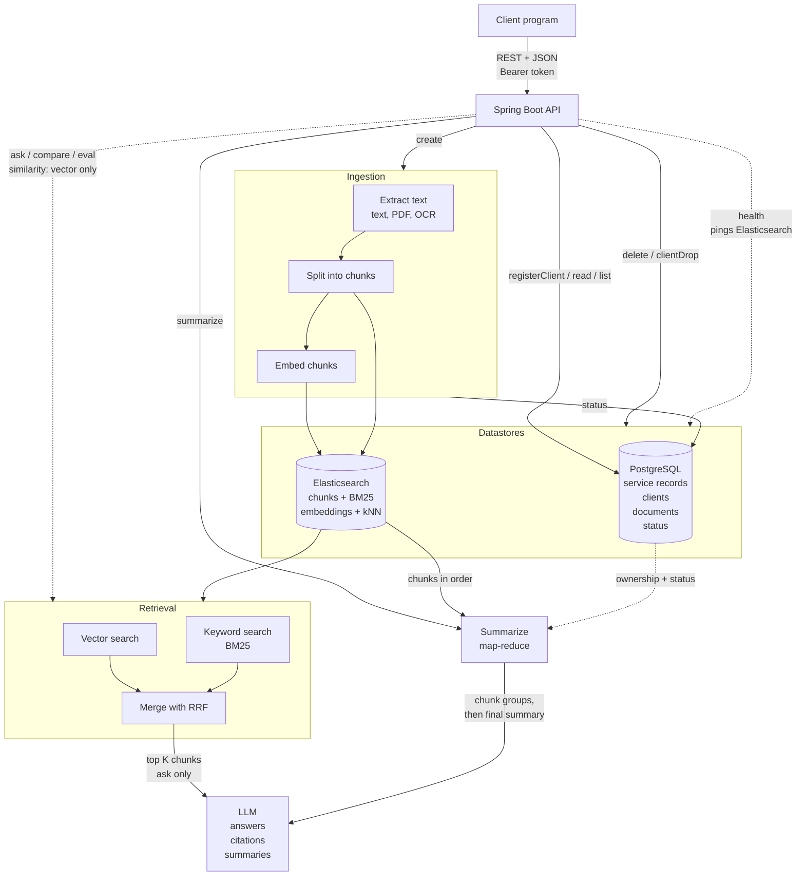
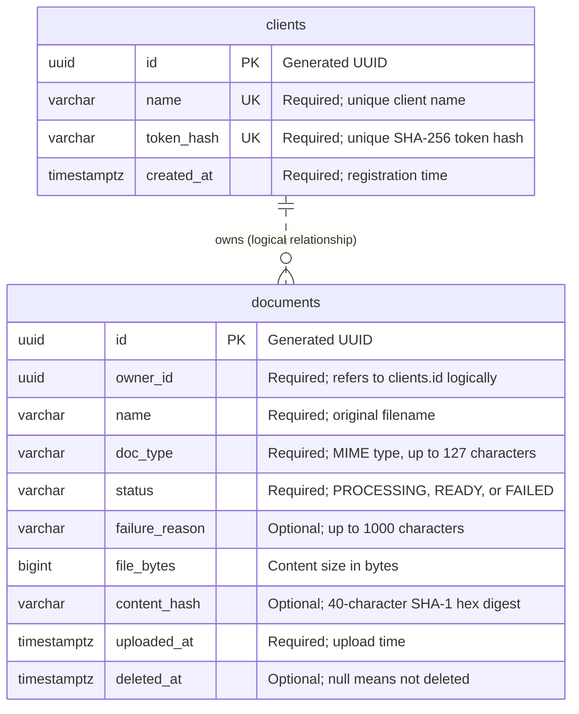

# KnowledgeDrop

KnowledgeDrop is a REST API that works like a drop box for knowledge. Client programs upload documents (PDF, text, images), and the service indexes them for semantic and keyword retrieval. It answers questions grounded in the stored documents with citations, summarizes documents, and finds similar documents. It also includes built-in tooling to compare and evaluate retrieval strategies.

## Why Hybrid Retrieval

Vector search is strong at meaning (for example, "How do I cancel?" matching a termination policy) but weak at exact terms such as error codes, IDs, and names. Keyword search (Elasticsearch BM25) is the opposite. KnowledgeDrop runs both inside Elasticsearch (semantic vector search over `dense_vector` embeddings, plus BM25 over the chunk text) and merges the result lists with Reciprocal Rank Fusion (RRF), which retrieves better than either method alone. The `compare` and `eval` endpoints measure that claim with real numbers.

## Architecture



- **Spring Boot:** REST endpoints, request validation, client authentication, and the service's own records of clients and documents.
- **PostgreSQL:** stores those records (owner, name, type, upload time, status) through JPA.
- **Elasticsearch:** stores chunk text, metadata, and chunk embeddings. It serves semantic vector search (kNN over `dense_vector` fields) and keyword search (BM25).
- **LLM:** generates answers from retrieved context and produces summaries.
- **Scoping:** every query is filtered by client, so one client never sees another client's data.

All API traffic uses REST with JSON request and response bodies.

## Database Schema

PostgreSQL stores two tables: `clients` for registered API clients and `documents` for uploaded document metadata. One client can own zero or many documents; each document records one owner's ID.



- **Keys and ownership:** `PK` = primary key; `UK` = unique column. The ownership relationship is logical: `owner_id` has no declared foreign key or cascading deletion.
- **Document names:** uniqueness per owner among non-deleted documents must be enforced by the application; there is no database unique constraint on `(owner_id, name)`.
- **Soft deletion:** `deleted_at IS NULL` identifies non-deleted records. Queries must apply this filter explicitly; ingestion `status` is independent.
- **Storage:** PostgreSQL holds metadata, not file contents. Chunk text and embeddings live in Elasticsearch, keyed by document ID.
- **Schema source:** [ClientRecord](src/main/java/dev/coms4156/knowledgedrop/model/ClientRecord.java) and [DocumentRecord](src/main/java/dev/coms4156/knowledgedrop/model/DocumentRecord.java) define the mappings. [application.yml](src/main/resources/application.yml) enables `ddl-auto: update` at startup; obsolete columns or constraints may remain in existing databases.

## Conventions

- **Authentication:** the client token returned by `registerClient` is sent as `Authorization: Bearer <token>` on every endpoint except `registerClient` and `health`. Invalid or missing tokens return HTTP 401. Only a SHA-256 hash of the token is stored.
- **Document status:** each document is `processing` (being ingested), `ready` (searchable), or `failed`. Search, `ask`, `similarity`, and `summarize` only use `ready` documents.
- **Document names:** a document's name is the original filename of the uploaded file. A document can be referenced by ID or by name, so names are unique per client among non-deleted documents. Uploading a file whose name matches one of the client's existing documents replaces that document's content (keeping its document ID) and re-ingests it. `create` returns HTTP 400 if the upload has no filename.
- **Ingestion pipeline:** `create` extracts text (direct read for text files, text extraction for PDFs, OCR for images, keeping page numbers), splits it into chunks, embeds each chunk into the Elasticsearch vector store, and indexes each chunk's text in Elasticsearch for keyword search. Ingestion runs in the background, so `create` returns `202 Accepted` with status `processing`.
- **Errors:** always `{"error": "Not Found", "reason": "..."}`.

## API Reference

All paths are under `/knowledgeDrop`.

### Client Registration

| Method | Endpoint | Inputs | Behavior |
|---|---|---|---|
| POST | `/knowledgeDrop/registerClient` | Client object (client name) | Creates a client with a new client ID and token. Returns both, or HTTP 409 if the name is already registered. |
| DELETE | `/knowledgeDrop/clientDrop` | Token, client ID | Verifies the token matches the client ID, then deletes all of the client's documents (files, Elasticsearch chunk entries and embeddings), the client record, and the token. |

### Document Management

| Method | Endpoint | Inputs | Behavior |
|---|---|---|---|
| POST | `/knowledgeDrop/create` | Token, file (a multipart `file` part) | Uses the file's original filename as the document name and its content type (for example, `application/pdf` or `text/plain`) as the MIME type. If the client already has a non-deleted document with that name, deletes its existing chunks and embeddings from Elasticsearch, replaces its content, and re-ingests it under the same document ID. Otherwise creates a new document. Stores the file, runs the ingestion pipeline, and returns the document ID and status `processing`. Errors on a missing filename, an unsupported type, or empty content. |
| GET | `/knowledgeDrop/read` | Token, document ID or name | Returns the content, ID, filename, type, upload time, and status, or HTTP 404. |
| DELETE | `/knowledgeDrop/delete` | Token, document ID or name | Deletes the stored file, its Elasticsearch chunk entries and embeddings, and the document record. |
| GET | `/knowledgeDrop/list` | Token, optional `status`, `limit`, `offset` | Returns the client's documents with ID, filename, type, upload time, and status. Returns an empty list if there are none. |

### Question Answering and Similarity

| Method | Endpoint | Inputs | Behavior |
|---|---|---|---|
| POST | `/knowledgeDrop/ask` | Token, question, optional `k` (default 5) | Runs hybrid retrieval (vector plus BM25, merged with RRF) over the client's `ready` documents, passes the top `k` chunks to an LLM, and returns the answer with citations (document ID, filename, page, snippet). Says so if nothing relevant is found. |
| POST | `/knowledgeDrop/similarity` | Token, text to compare, optional `k` (default 5) | Embeds the input, compares it with the client's stored chunk embeddings, and returns the top `k` documents with ID, filename, similarity score, and best-matching snippet. |

### Search Evaluation and Summarization

| Method | Endpoint | Inputs | Behavior |
|---|---|---|---|
| POST | `/knowledgeDrop/compare` | Token, query text, optional `k` (default 5) | Runs the query through vector, keyword, and hybrid (RRF) search. Returns the top `k` chunks per mode with document ID, filename, page, snippet, and score, plus an overlap summary. |
| POST | `/knowledgeDrop/eval` | Token, labeled question set, optional `k` (default 5) | Runs each question through all three modes and computes recall@k and MRR per mode, with a per-question rank breakdown. Errors if labels reference documents the client does not own. |
| POST | `/knowledgeDrop/summarize` | Token, document ID, optional `length` (`short` or `detailed`) | Verifies ownership and that the document is `ready`. For long documents, summarizes groups of chunks first, then combines them into a final summary (map-reduce). Returns summary text, document ID, and number of chunks used. |

### Service Health

| Method | Endpoint | Behavior |
|---|---|---|
| GET | `/knowledgeDrop/health` | No token required. Pings Elasticsearch. Returns HTTP 200 if it is reachable, 503 if it is down, with the dependency status. |

## Example Client Programs

- **Insurance coverage lookup:** a program in a hospital's billing system that uploads plan documents and payer contracts with `create`, calls `ask` with coverage questions, and attaches the returned citations to the claim record. It uses `list` and `delete` to keep plan documents current.
- **Essay originality checker:** a program in a school's submission system that calls `similarity` on each submitted essay and flags the submission when the top score exceeds a threshold. It then calls `create` to add the accepted essay to the collection. It never calls `ask`.

## Tech Stack

- **Language and framework:** Java 17, Spring Boot
- **Datastores:** PostgreSQL (service records), Elasticsearch (semantic vector store and keyword search)
- **Local infrastructure:** Docker Compose
- **Data format:** JSON

## Local Development

Requires JDK 17 (newer JDKs break PMD) and Docker Desktop. No Maven install needed; use the wrapper.

```bash
docker compose up -d     # PostgreSQL, Elasticsearch
./mvnw verify            # compile, test, JaCoCo report and minimum, Checkstyle, PMD (all enforced)
./mvnw spring-boot:run   # start on http://localhost:8080
docker compose down      # stop the datastores (add -v to wipe their data)
```

Defaults match `src/main/resources/application.yml`. **Tests do not need Docker**: they run against in-memory H2 (`application-test.yml`).

If `./mvnw` says permission denied, run `chmod +x mvnw`.

### Configuration

Settings and secrets live in a local `.env` file, which is gitignored. Copy the template and edit it:

```bash
cp .env.example .env
```

Spring loads `.env` on startup (`spring.config.import`) and Docker Compose reads it too, so one file drives both. A missing `.env` is fine: every value has a local default, which is why tests and CI need no setup.

| Variable | Used for |
|---|---|
| `DB_URL`, `DB_USER`, `DB_PASSWORD` | PostgreSQL (also the Postgres container's credentials) |
| `ELASTICSEARCH_URIS` | Elasticsearch |
| `EMBEDDING_BASE_URL`, `EMBEDDING_MODEL`, `EMBEDDING_DIMENSION` | Embedding service |
| `LLM_PROVIDER`, `LLM_API_KEY`, `LLM_MODEL` | Hosted LLM |

Never commit `.env`. Add new variables to `.env.example` with a safe placeholder.

### Try it

```bash
curl -s -X POST localhost:8080/knowledgeDrop/registerClient \
  -H 'Content-Type: application/json' -d '{"clientName":"demo"}'
# => {"clientId":"...","clientToken":"..."}   (token is shown once)

TOKEN=<clientToken>
curl -s localhost:8080/knowledgeDrop/list -H "Authorization: Bearer $TOKEN"

# create: a single file part; the document name is the file's name (policy.pdf)
curl -s -X POST localhost:8080/knowledgeDrop/create -H "Authorization: Bearer $TOKEN" \
  -F 'file=@policy.pdf;type=application/pdf'
```

`create` uses `multipart/form-data` with a binary `file` part. The document name is the file's original filename, and the MIME type is the file's content type (the filename extension is used if the client sends `application/octet-stream`). Uploading again with the same filename replaces that document's content.

### Implementation status

Endpoint logic that is not built yet is marked with a `TODO:` comment that names the endpoint (for example `TODO: create: ...`) and returns `501 Not Implemented`. The AI-dependent items are **DEFERRED** until an LLM and embedding provider are chosen. Find every open item with `grep -rn "TODO:" src/main`. Matching disabled tests live in `EndpointTodoTests`; move each into a real test class as you build the endpoint.

| Endpoint | Status | Implement in |
|---|---|---|
| `POST registerClient` | **Built** (reference implementation) | `ClientService.register` |
| `POST create` (also replaces a same-name document) | To do | `DocumentService.create` |
| `GET read` | To do | `DocumentService.read` |
| `DELETE delete` | To do | `DocumentService.delete` |
| `GET list` | To do | `DocumentService.list` |
| `DELETE clientDrop` | To do | `ClientService.drop` |
| `GET health` | To do | `HealthService.check` |
| Ingestion pipeline (extract, chunk, keyword index) | To do | `IngestionService` |
| `POST ask` | **DEFERRED** (LLM + embeddings) | `AskService.ask` |
| `POST similarity` | **DEFERRED** (embeddings) | `AskService.similarity` |
| `POST compare` | **DEFERRED** (embeddings) | `SearchService.compare` |
| `POST eval` | **DEFERRED** (embeddings) | `SearchService.eval` |
| `POST summarize` | **DEFERRED** (LLM) | `SummarizationService.summarize` |
| Chunk embeddings in Elasticsearch, RRF | **DEFERRED** | `IngestionService`, `retrieval/` package |

### Code layout

```
src/main/java/dev/coms4156/knowledgedrop/
  api/          controllers (wiring, params, status codes) + api/dto request/response records
  service/      business logic; stubs carry the TODOs
  retrieval/    VectorStore, KeywordIndex, EmbeddingClient, LlmClient, RrfMerger, RetrievalService
  model/        JPA entities (ClientRecord, DocumentRecord) and enums
  repository/   Spring Data JPA repositories (always scoped to the owning client)
  security/     AuthInterceptor (Bearer token -> client), TokenUtils (generate + SHA-256 hash)
  exception/    ApiException, ErrorResponse, GlobalExceptionHandler
  config/       WebConfig (auth on /knowledgeDrop/**), AsyncConfig, KnowledgeDropProperties
```

Adding an endpoint: fill in the service method (the controller, DTOs, auth, and error handling are already wired). `ClientService.register` plus `ClientServiceTest` and `ApiAuthIntegrationTest` show the pattern.

## Development Tools

| Category | Tool |
|---|---|
| Continuous integration | GitHub Actions (`.github/workflows/ci.yml`) |
| Build and dependency manager | Maven (Maven Wrapper) |
| Unit testing | JUnit 5 (Spring Boot Starter Test), MockMvc |
| API testing over the network | Postman, curl |
| Mocking | Mockito (Spring Boot Starter Test) |
| Test coverage | JaCoCo (`target/site/jacoco/index.html`) |
| Style checker | Checkstyle (Google Java Style) |
| Static analysis | PMD |
| Local infrastructure | Docker Compose |
| Project management | Jira Kanban board |
| IDE | Visual Studio Code |

### Quality gates

Checkstyle, PMD, and JaCoCo are enforced: `./mvnw verify` (and CI) fails on any Checkstyle or PMD violation, or when line coverage falls below the minimum. The settings live in `pom.xml` `<properties>`:

```xml
<quality.failOnViolation>true</quality.failOnViolation>
<quality.checkstyle.severity>warning</quality.checkstyle.severity>
<jacoco.line.coverage.min>0.50</jacoco.line.coverage.min>
```

Coverage is a ratchet. The minimum starts at the current baseline and is raised as features and tests land, never lowered. The target is 85% or more by project completion. Each feature PR includes its own tests.

## Design Assumptions

- Spring Boot 4.1 on Java 17; package `dev.coms4156.knowledgedrop`.
- Records (clients, documents) in PostgreSQL via JPA; `ddl-auto: update` for dev, so add Flyway (or similar) migrations before a real deployment. Original uploads go under `./data/files`.
- 501 stubs return the normal JSON error body so the API contract is testable before the logic.

## Team

- Daniel Krasner (dk3460)
- Patrick Salsbury (prs2153)
- Ishan Akhouri (ia2659)
