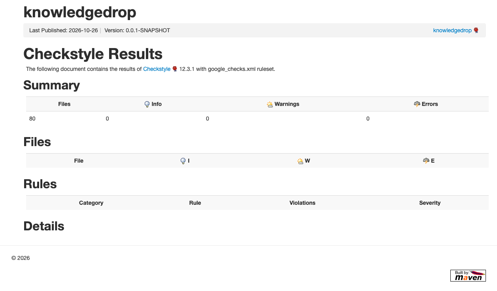
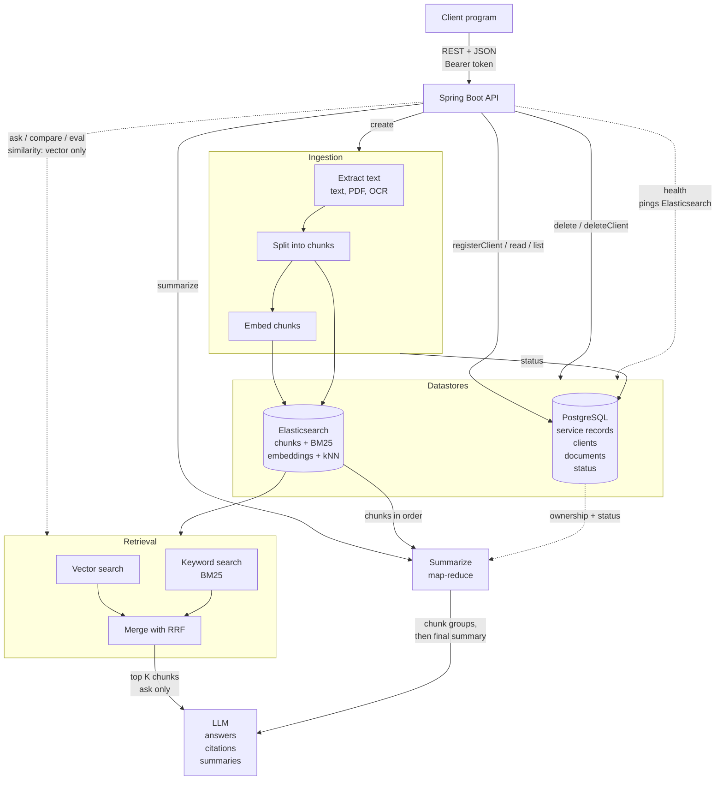
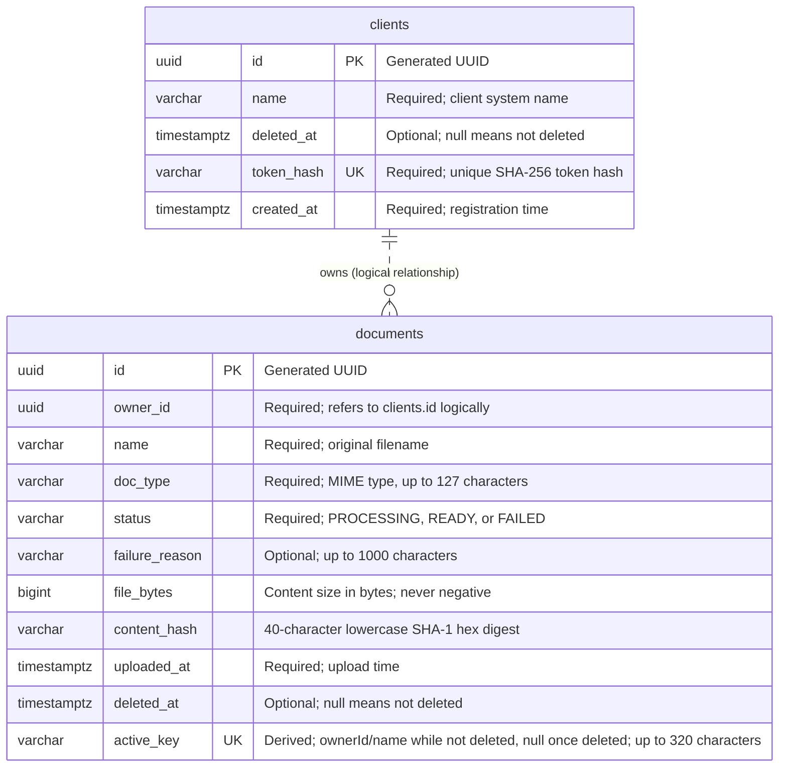

# KnowledgeDrop

KnowledgeDrop is a REST API that works like a drop box for knowledge. The proposed service lets client programs upload documents (PDF, text, images), indexes them for semantic and keyword retrieval, answers questions with citations, summarizes documents, and finds similar documents. It also includes proposed tooling to compare and evaluate retrieval strategies. The first iteration implements the subset described below.

## AI Disclosure

#### Models used
- Codex (OpenAI)
- Claude (Anthropic)

### Token usage
- Estimated token usage: 40m per person (monthly plan)

#### AI contributions
Our team used various AI models throughout development to assist with creating the initial project structure, implementing features, debugging code, reviewing changes, generating and refining tests, and improving code readability. AI also supported documentation, including API descriptions, architecture and database diagrams, README updates, setup instructions, and explanations of implemented functionality and known limitations.
Prompts generally involved translating requirements into code, explaining implementation choices, investigating errors, suggesting fixes, identifying edge cases, generating tests, and revising documentation to match the project’s behavior. Specific prompt histories and token usage totals were not recorded in this disclosure.

## Project Management

[Jira task log — KnowledgeDrop](https://ishancolumbiacs.atlassian.net/jira/software/projects/KD/list?jql=project%20%3D%20KD%20ORDER%20BY%20cf%5B10019%5D%20ASC)

We organize development in Jira around the six initiatives listed below. The counts include tasks and stories from the October 25, 2026 issue snapshot; they describe planned work, not release completion.

| Epic | Related tasks/stories | Initiative |
|---|---:|---|
| **Project Setup (D-2)** | 3 | Establish quality gates, configuration management for secrets and providers, and GitHub Actions CI. |
| **Document Management (KD-11)** | 5 | Build document creation, reading, listing, deletion, and the supporting metadata model. |
| **RAG/Retrieval (KD-14)** | 11 | Develop ingestion, keyword and vector search, hybrid ranking, retrieval orchestration, and embedding/LLM integrations. |
| **Evaluation (KD-24)** | 4 | Compare retrieval strategies using recall@k and MRR, labeled questions, sample documents, and a results write-up. |
| **Client Management (KD-33)** | 2 | Implement client registration and client deletion. |
| **Miscellaneous (KD-40)** | 1 | Add application logging. |

One additional task covers selecting embedding/LLM providers (KD-8), bringing the total to **27 tasks/stories across the listed initiatives and standalone work**. Individual assignments and progress are tracked in the linked Jira task log.

## First Iteration MVP

This iteration focuses on authenticated file storage and document metadata management. Retrieval and AI features are deferred; the architecture and broader API reference describe the intended service, while this section and the implementation-status table identify what is available now.

### Implemented scope

All paths below are relative to `/knowledgeDrop`.

| Endpoint | Available behavior |
|---|---|
| `POST /client/register` | Registers a client and returns its ID and bearer token. |
| `DELETE /client/delete` | Soft-deletes the authenticated client and its document records; subsequent requests with that token return HTTP 401. Files and Elasticsearch data are retained. |
| `POST /document/create` | For a new filename, stores the original file and its metadata and returns HTTP 202 with status `processing`. Text extraction and indexing are not implemented. |
| `GET /document/read` | Returns the caller's stored original file by name, checking its content hash before streaming. Does not require ingestion to finish. |
| `GET /document/list` | Lists the caller's non-deleted document metadata, with status filtering and pagination. |

Protected endpoints require the token returned by registration. Register first, upload a file with a new name, then read or list it. Delete the client only after completing other calls with its token.

### Deferred features and known limitations

- **Ingestion is deferred.** The asynchronous ingestion method currently throws a not-implemented error, which is logged after a new-name upload. The file remains readable, but its record stays `processing`; it does not become `ready` or searchable.
- **Document deletion and same-name replacement are incomplete and excluded from the demonstrated MVP.** Both call the unimplemented `deleteChunks` method and return HTTP 501 after database changes have committed. Deletion leaves the document soft-deleted; replacement overwrites the stored file and creates a new record but does not start its ingestion. Do not treat the error as evidence that no changes occurred.
- **Question answering, similarity, comparison, evaluation, summarization, and health checks are deferred.** Their endpoint implementations currently return HTTP 501. Keyword indexing and RRF have component implementations and tests, but are not connected into a working upload-to-search API workflow.

### Demonstrating the implemented workflow

Follow **Local Development** below to start the dependencies and application. These commands use a fresh client so the filename is new. Copy `clientToken` and `clientId` from the registration response into the indicated variables.

```bash
BASE=http://localhost:8080/knowledgeDrop
curl -i -X POST "$BASE/client/register" \
  -H 'Content-Type: application/json' -d '{"name":"iteration-one-demo"}'
# Expected: 201, with clientId and clientToken.

TOKEN='paste-clientToken-here'
CLIENT_ID='paste-clientId-here'
printf 'First iteration document.\n' > /tmp/knowledgedrop-demo.txt
curl -i -X POST "$BASE/document/create" \
  -H "Authorization: Bearer $TOKEN" \
  -F 'file=@/tmp/knowledgedrop-demo.txt;type=text/plain'
# Expected: 202, with documentId and status processing (ingestion is deferred).

curl -i "$BASE/document/list" -H "Authorization: Bearer $TOKEN"
# Expected: 200, with the uploaded document's metadata.

curl -i -G "$BASE/document/read" -H "Authorization: Bearer $TOKEN" \
  --data-urlencode 'documentName=knowledgedrop-demo.txt'
# Expected: 200, with the original text as the response body.

# Bad usage: protected request without a token.
curl -i "$BASE/document/list"
# Expected: 401.

# Bad usage: read a filename that this client has not uploaded.
curl -i -G "$BASE/document/read" -H "Authorization: Bearer $TOKEN" \
  --data-urlencode 'documentName=missing.txt'
# Expected: 404, with a JSON error and reason.

curl -i -X DELETE "$BASE/client/delete" \
  -H "Authorization: Bearer $TOKEN" -H 'Content-Type: application/json' \
  -d "{\"clientId\":\"$CLIENT_ID\"}"
# Expected: 200; client and document records are soft-deleted.

curl -i "$BASE/document/list" -H "Authorization: Bearer $TOKEN"
# Expected: 401 because the client has been deleted.
```

### Style Report

We use Checkstyle with Google Java Style (`google_checks.xml`), configured in `pom.xml`, to check application and test code.

Run: `./mvnw checkstyle:check`



[Full Checkstyle XML report](reports/style/checkstyle-result.xml)
— zero violations.

## Why Hybrid Retrieval

Vector search is strong at meaning (for example, "How do I cancel?" matching a termination policy) but weak at exact terms such as error codes, IDs, and names. Keyword search (Elasticsearch BM25) is the opposite. KnowledgeDrop runs both inside Elasticsearch (semantic vector search over `dense_vector` embeddings, plus BM25 over the chunk text) and merges the result lists with Reciprocal Rank Fusion (RRF), which retrieves better than either method alone. The `compare` and `eval` endpoints measure that claim with real numbers.

## Architecture



- **Spring Boot:** REST endpoints, request validation, client authentication, and the service's own records of clients and documents.
- **PostgreSQL:** stores those records (owner, name, type, upload time, status) through JPA.
- **Elasticsearch:** stores chunk text, metadata, and chunk embeddings. It serves semantic vector search (kNN over `dense_vector` fields) and keyword search (BM25).
- **LLM:** generates answers from retrieved context and produces summaries.
- **Scoping:** every query is filtered by client, so one client never sees another client's data.

The API uses REST and JSON responses. Registration takes a system name in a JSON request body.

## Database Schema

PostgreSQL stores two tables: `clients` for registered API clients and `documents` for uploaded document metadata. One client can own zero or many documents; each document records one owner's ID.



- **Keys and ownership:** `PK` = primary key; `UK` = unique column. The ownership relationship is logical: `owner_id` has no declared foreign key or cascading deletion.
- **Document names:** `(owner_id, name)` is unique among non-deleted documents. The database enforces this through the unique `active_key` column (constraint `uk_documents_active_owner_name`) rather than a plain unique constraint on `(owner_id, name)`, which would block re-uploading a deleted name.
- **`active_key`:** derived by `DocumentRecord`, never set directly. It holds `ownerId/name` while `deleted_at` is null and becomes null when the document is soft-deleted. Unique constraints allow multiple nulls, so any number of deleted documents may share a name. Clearing `deleted_at` claims the name again and fails at save time if another non-deleted document already holds it.
- **Soft deletion:** `deleted_at IS NULL` identifies non-deleted records. Queries must apply this filter explicitly; ingestion `status` is independent. `DocumentRecord.setDeletedAt` keeps `active_key` in sync.
- **Content metadata:** `file_bytes` and `content_hash` are computed by `DocumentService` at upload and validated by the `DocumentRecord` constructor (size must not be negative; hash must be 40 lowercase hex characters). `document/read` recomputes the stored file's SHA-1 and fails with HTTP 500 if it does not match `content_hash`.
- **Status lifecycle:** a new record starts as `PROCESSING`. `markReady` and `markProcessing` clear `failure_reason`; `markFailed` stores the reason, truncated to 1000 characters.
- **Storage:** PostgreSQL holds metadata, not file contents. Chunk text and embeddings live in Elasticsearch, keyed by document ID.
- **Schema source:** [ClientRecord](src/main/java/dev/coms4156/knowledgedrop/model/ClientRecord.java) and [DocumentRecord](src/main/java/dev/coms4156/knowledgedrop/model/DocumentRecord.java) define the mappings. [application.yml](src/main/resources/application.yml) enables `ddl-auto: update` at startup; obsolete columns or constraints may remain in existing databases. Rows created before `active_key` existed have it null and are not covered by the name constraint; for local development, wipe the data volumes (see Client Registration).

## Conventions

- **Authentication:** the client token returned by `client/register` is sent as `Authorization: Bearer <token>` on every endpoint except `client/register` and `health`. Invalid or missing tokens return HTTP 401. Only a SHA-256 hash of the token is stored.
- **Document status:** each document is `processing` (being ingested), `ready` (searchable), or `failed`. Search, `ask`, `similarity`, and `summarize` only use `ready` documents.
- **Document names:** a document's name is the original filename of the uploaded file. `read` and `delete` identify a document by its name (the `documentName` query parameter), so names are unique per client among non-deleted documents. Soft-deleted documents are ignored by name lookups, so a deleted name can be reused by a later `create`. Uploading a file whose name matches one of the client's existing documents soft-deletes that document and stores the upload as a new document with a new document ID, which is then ingested. `create` returns HTTP 400 if the upload has no filename.
- **Upload requirements:** an uploaded file must not be empty, must not be larger than 10 GB, and must have a non-blank filename (the filename becomes the document name). `create` rejects any upload that breaks these rules.
- **Ingestion pipeline:** `create` extracts text (direct read for text files, text extraction for PDFs, OCR for images, keeping page numbers), splits it into chunks, embeds each chunk into the Elasticsearch vector store, and indexes each chunk's text in Elasticsearch for keyword search. Ingestion runs in the background, so `create` returns `202 Accepted` with status `processing`.
- **Responses:** endpoints return JSON, except `document/read`, which returns the raw file bytes with the document's own content type.
- **Errors:** always `{"error": "Not Found", "reason": "..."}`.

## API Reference

All paths are under `/knowledgeDrop`. Document management endpoints are grouped under the `/knowledgeDrop/document` prefix (for example `POST /knowledgeDrop/document/create`). This reference includes intended behavior for unfinished features; consult **First Iteration MVP** above for current availability, particularly the incomplete deletion, replacement, and ingestion paths.

### Client Registration

| Method | Endpoint | Inputs | Behavior |
|---|---|---|---|
| POST | `/knowledgeDrop/client/register` | JSON body with a required `name` field | Returns HTTP 201 with `clientId` (UUID) and `clientToken`. Stores only the SHA-256 token hash. Names may repeat; invalid or missing fields return HTTP 400. |
| DELETE | `/knowledgeDrop/client/delete` | Bearer token, JSON body with required `clientId` (UUID) | Only the token owner can delete itself (otherwise HTTP 403). Returns HTTP 200 with a confirmation; soft-deletes the client and all owned documents in one transaction using the same timestamp. |

Registration replaces the former `/knowledgeDrop/registerClient` JSON-body endpoint.
The system name must be nonblank and at most 255 characters; surrounding whitespace is removed.
New clients have `deleted_at = NULL`; deleted clients cannot authenticate.
Delete requests use `Content-Type: application/json` with a body such as
`{"clientId":"123e4567-e89b-42d3-a456-426614174000"}` and the client's bearer token.
Deleting a client sets `deleted_at` on every owned document, including previously deleted
documents, to the client deletion timestamp. Rows, token hashes, files, and Elasticsearch
data are retained. Subsequent requests using the deleted client’s token return HTTP 401.

Local development data is disposable. If your database still uses the former `first_name`,
`last_name`, or `is_active` columns, stop the application and run `docker compose down -v` to wipe the PostgreSQL and
Elasticsearch data volumes, then run `docker compose up -d` and restart the application.
Hibernate creates the current schema in the fresh database; no migration is needed.

#### Client tokens

Registration uses Java's `SecureRandom` to generate 32 random bytes (256 bits), encoded as
URL-safe Base64 without padding. This original token is returned once as `clientToken`.
The database stores only its SHA-256 hash in `clients.token_hash` (64 lowercase hexadecimal
characters), never the plaintext token.

Clients send the original token as `Authorization: Bearer <clientToken>` on protected requests.
The server hashes that token with SHA-256 and looks up the matching client. The same token always
produces the same hash, so no decryption is needed. Authentication succeeds only if a matching
client exists and its `deleted_at` is null; otherwise the request returns HTTP 401.
Clients can only delete themselves. The supplied `clientId` must match the client associated
with the bearer token; attempting to delete another client returns HTTP 403.
Registration and health checks require no token.

### Document Management

| Method | Endpoint | Inputs | Behavior |
|---|---|---|---|
| POST | `/knowledgeDrop/document/create` | Token, file (a multipart `file` part) | Uses the file's original filename as the document name and its content type (for example, `application/pdf` or `text/plain`) as the MIME type. If the client already has a non-deleted document with that name, soft-deletes it and creates the new document in the same transaction; once that commits, removes the old document's chunks and embeddings from Elasticsearch (via `IngestionService.deleteChunks`), so the old document no longer appears in search. Always creates a new document with a new document ID, saves the file to disk (overwriting any earlier file stored under the same client and name), records its SHA-1 hash and size, starts the background ingestion pipeline, and returns HTTP 202 with the new document ID and status `processing`. Returns HTTP 400 for a missing or blank filename or empty content, and HTTP 413 for a file larger than 10 GB. |
| GET | `/knowledgeDrop/document/read` | Token, `documentName` | Looks up the client's non-deleted document with that name. Returns the stored file itself as the raw response body (a Spring `ResponseEntity<InputStreamResource>`, streamed from storage), not a JSON object. The `Content-Type` header is the document's stored MIME type and `Content-Length` is its size in bytes. Before streaming, recomputes the stored file's SHA-1 and returns HTTP 500 if it does not match the hash recorded at upload. Returns HTTP 404 (JSON error body) if there is none (including if it was deleted), or HTTP 400 if `documentName` is missing or blank. Use `document/list` to get a document's ID, type, upload time, and status. |
| DELETE | `/knowledgeDrop/document/delete` | Token, `documentName` | Soft-deletes the client's non-deleted document with that name by setting `deleted_at` on its record, then asks `IngestionService.deleteChunks` to remove its Elasticsearch chunk entries and embeddings so it no longer appears in search. The stored file is kept, and the name can be reused by a later `create`. Returns HTTP 200 with a confirmation message, HTTP 404 if there is none, or HTTP 400 if `documentName` is missing or blank. |
| GET | `/knowledgeDrop/document/list` | Token, optional `status`, `limit`, `offset` (query parameters) | Returns a JSON array of the client's non-deleted documents, newest upload first. Each entry has `documentId`, `filename`, `type`, `uploadTime`, and `status`. `status` filters by `processing`, `ready`, `failed`, or `all` (case-insensitive; omitted, blank, or `all` returns every status); any other value returns HTTP 400. `limit` is the page size and `offset` is the number of documents to skip. A missing, zero, or negative `limit` defaults to 1000, and a missing or negative `offset` is treated as 0. Returns an empty list if there are none. |

### Question Answering and Similarity

| Method | Endpoint | Inputs | Behavior |
|---|---|---|---|
| POST | `/knowledgeDrop/ask` | Token, question, optional `k` (default 5) | Runs hybrid retrieval (vector plus BM25, merged with RRF) over the client's `ready` documents, passes the top `k` chunks to an LLM, and returns the answer with citations (document ID, filename, page, snippet). Says so if nothing relevant is found. |
| POST | `/knowledgeDrop/similarity` | Token, text to compare, optional `k` (default 5) | Embeds the input, compares it with the client's stored chunk embeddings, and returns the top `k` documents with ID, filename, similarity score, and best-matching snippet. |

### Search Evaluation and Summarization

| Method | Endpoint | Inputs | Behavior |
|---|---|---|---|
| POST | `/knowledgeDrop/compare` | Token, query text, optional `k` (default 5) | Runs the query through vector, keyword, and hybrid (RRF) search. Returns the top `k` chunks per mode with document ID, filename, page, snippet, and score, plus an overlap summary. |
| POST | `/knowledgeDrop/eval` | Token, labeled question set, optional `k` (default 5) | Runs each question through all three modes and computes recall@k and MRR per mode, with a per-question rank breakdown. Errors if labels reference documents the client does not own. |
| POST | `/knowledgeDrop/summarize` | Token, document ID, optional `length` (`short` or `detailed`) | Verifies ownership and that the document is `ready`. For long documents, summarizes groups of chunks first, then combines them into a final summary (map-reduce). Returns summary text, document ID, and number of chunks used. |

### Service Health

| Method | Endpoint | Behavior |
|---|---|---|
| GET | `/knowledgeDrop/health` | No token required. Pings Elasticsearch. Returns HTTP 200 if it is reachable, 503 if it is down, with the dependency status. |

## Example Client Programs

- **Insurance coverage lookup:** a program in a hospital's billing system that uploads plan documents and payer contracts with `create`, calls `ask` with coverage questions, and attaches the returned citations to the claim record. It uses `list` and `delete` to keep plan documents current.
- **Essay originality checker:** a program in a school's submission system that calls `similarity` on each submitted essay and flags the submission when the top score exceeds a threshold. It then calls `create` to add the accepted essay to the collection. It never calls `ask`.

## Tech Stack

- **Language and framework:** Java 17, Spring Boot
- **Datastores:** PostgreSQL (service records), Elasticsearch (semantic vector store and keyword search)
- **Embeddings:** `all-MiniLM-L6-v2` (384 dimensions, open source) from a local sentence-transformers service, so no API key or per-call cost
- **LLM:** Gemini Flash (free tier is enough for development) behind the `LlmClient` interface; the API key lives in `.env` only
- **Local infrastructure:** Docker Compose
- **Data format:** JSON

## Local Development

Requires JDK 17 (newer JDKs break PMD) and Docker Desktop. No Maven install needed; use the wrapper.

```bash
docker compose up -d     # PostgreSQL, Elasticsearch
./mvnw verify            # compile, test, JaCoCo report and minimum, Checkstyle, PMD (all enforced)
./mvnw spring-boot:run   # start on http://localhost:8080
docker compose down      # stop the datastores (add -v to wipe their data)
```

Defaults match `src/main/resources/application.yml`. Tests use in-memory H2 for the database (`application-test.yml`), but the Elasticsearch integration tests need Elasticsearch running, so run `docker compose up -d` before `./mvnw verify`.

If `./mvnw` says permission denied, run `chmod +x mvnw`.

### Configuration

Settings and secrets live in a local `.env` file, which is gitignored. Copy the template and edit it:

```bash
cp .env.example .env
```

Spring loads `.env` on startup (`spring.config.import`) and Docker Compose reads it too, so one file drives both. A missing `.env` is fine: every value has a local default.

| Variable | Used for |
|---|---|
| `DB_URL`, `DB_USER`, `DB_PASSWORD` | PostgreSQL (also the Postgres container's credentials) |
| `ELASTICSEARCH_URIS` | Elasticsearch |
| `EMBEDDING_BASE_URL`, `EMBEDDING_MODEL`, `EMBEDDING_DIMENSION` | Embedding service |
| `LLM_PROVIDER`, `LLM_API_KEY`, `LLM_MODEL` | Hosted LLM |

Never commit `.env`. Add new variables to `.env.example` with a safe placeholder.

### Try it

```bash
curl -s -X POST localhost:8080/knowledgeDrop/client/register \
  -H 'Content-Type: application/json' \
  -d '{"name":"billing-system"}'
# => {"clientId":"...","clientToken":"..."}   (token is shown once)

TOKEN=<clientToken>
curl -s localhost:8080/knowledgeDrop/document/list -H "Authorization: Bearer $TOKEN"

# list: filter by status and paginate (the 2nd page of 10 ready documents)
curl -s -G localhost:8080/knowledgeDrop/document/list -H "Authorization: Bearer $TOKEN" \
  --data-urlencode 'status=ready' --data-urlencode 'limit=10' --data-urlencode 'offset=10'
# => [{"documentId":"...","filename":"policy.pdf","type":"application/pdf","uploadTime":"...","status":"ready"}]

# create: a single file part; the document name is the file's name (policy.pdf)
curl -s -X POST localhost:8080/knowledgeDrop/document/create -H "Authorization: Bearer $TOKEN" \
  -F 'file=@policy.pdf;type=application/pdf'

# read: returns the file itself, so save it to disk with -o
curl -s -G localhost:8080/knowledgeDrop/document/read -H "Authorization: Bearer $TOKEN" \
  --data-urlencode 'documentName=policy.pdf' -o policy-downloaded.pdf
```

`create` uses `multipart/form-data` with a binary `file` part. The document name is the file's original filename, and the MIME type is the file's content type as sent by the client. Original files are stored at `{storageDir}/{clientId}/{fileName}` (default `./data/files`). Uploading again with the same filename soft-deletes the earlier document and creates a new one with a new document ID.

### Implementation status

Endpoint logic that is not built yet is marked with a `TODO:` comment that names the endpoint (for example `TODO: create: ...`) and returns `501 Not Implemented`. The AI-dependent items are marked **DEFERRED**: the providers are chosen (see Tech Stack), but the embedding service and the Gemini client are not built yet. Find every open item with `grep -rn "TODO:" src/main`. Matching disabled tests live in `EndpointTodoTests`; move each into a real test class as you build the endpoint.

| Endpoint | Status | Implement in |
|---|---|---|
| `POST client/register` | **Built** | `ClientService.register` |
| `POST document/create` | **Partial**: new-name file storage and metadata creation work; ingestion is deferred. Same-name replacement changes state but returns 501 because chunk deletion is a stub | `DocumentService.create` |
| `GET document/read` | **Built** | `DocumentService.read` |
| `DELETE document/delete` | **Incomplete**: soft-deletes the record, then returns 501 because chunk deletion is a stub | `DocumentService.delete` |
| `GET document/list` | **Built** | `DocumentService.list` |
| `DELETE client/delete` | **Built** (client and document record soft-deletion; stored files and index data retained) | `ClientService.delete` |
| `GET health` | To do | `HealthService.check` |
| Ingestion pipeline (extract, chunk, keyword index) | To do | `IngestionService` |
| `POST ask` | **DEFERRED** (LLM + embeddings) | `AskService.ask` |
| `POST similarity` | **DEFERRED** (embeddings) | `AskService.similarity` |
| `POST compare` | **DEFERRED** (embeddings) | `SearchService.compare` |
| `POST eval` | **DEFERRED** (embeddings) | `SearchService.eval` |
| `POST summarize` | **DEFERRED** (LLM) | `SummarizationService.summarize` |
| Keyword index and RRF | **Built as components**, with tests; end-to-end ingestion/retrieval wiring is deferred | `ElasticsearchKeywordIndex`, `RrfMerger` |
| Chunk embeddings and vector/hybrid retrieval | **DEFERRED** | `IngestionService`, `retrieval/` package |

### Code layout

```
src/main/java/dev/coms4156/knowledgedrop/
  api/          controllers (wiring, params, status codes) + api/dto request/response records
  service/      business logic; stubs carry the TODOs
  retrieval/    VectorStore, KeywordIndex, EmbeddingClient, LlmClient, RrfMerger, RetrievalService
  model/        JPA entities (ClientRecord, DocumentRecord) and enums
  repository/   Spring Data JPA repositories (always scoped to the owning client)
  security/     AuthInterceptor (Bearer token -> client), TokenUtils (generate + SHA-256 hash)
  exception/    ApiException, ErrorResponse, GlobalExceptionHandler
  config/       WebConfig (auth on /knowledgeDrop/**), AsyncConfig, KnowledgeDropProperties
```

Adding an endpoint: fill in the service method (the controller, DTOs, auth, and error handling are already wired). `ClientService.register` plus `ClientServiceTest` and `ApiAuthIntegrationTest` show the pattern.

## Development Tools

| Category | Tool |
|---|---|
| Continuous integration | GitHub Actions (`.github/workflows/ci.yml`) |
| Build and dependency manager | Maven (Maven Wrapper) |
| Unit testing | JUnit 5 (Spring Boot Starter Test), MockMvc |
| API testing over the network | Postman, curl |
| Mocking | Mockito (Spring Boot Starter Test) |
| Test coverage | JaCoCo (`target/site/jacoco/index.html`) |
| Style checker | Checkstyle (Google Java Style) |
| Static analysis | PMD |
| Local infrastructure | Docker Compose |
| Project management | Jira Kanban board |
| IDE | Visual Studio Code |

### Quality gates

Checkstyle, PMD, and JaCoCo are enforced: `./mvnw verify` (and CI) fails on any Checkstyle or PMD violation, or when line coverage falls below the minimum. The settings live in `pom.xml` `<properties>`:

```xml
<quality.failOnViolation>true</quality.failOnViolation>
<quality.checkstyle.severity>warning</quality.checkstyle.severity>
<jacoco.line.coverage.min>0.50</jacoco.line.coverage.min>
```

Coverage is a ratchet. The minimum starts at the current baseline and is raised as features and tests land, never lowered. The target is 85% or more by project completion. Each feature PR includes its own tests.

## Design Assumptions

- Spring Boot 4.1 on Java 17; package `dev.coms4156.knowledgedrop`.
- Records (clients, documents) in PostgreSQL via JPA; `ddl-auto: update` for dev, so add Flyway (or similar) migrations before a real deployment. Original uploads go under `./data/files`.
- 501 stubs return the normal JSON error body so the API contract is testable before the logic.

## Team

- Daniel Krasner (dk3460)
- Patrick Salsbury (prs2153)
- Ishan Akhouri (ia2659)
